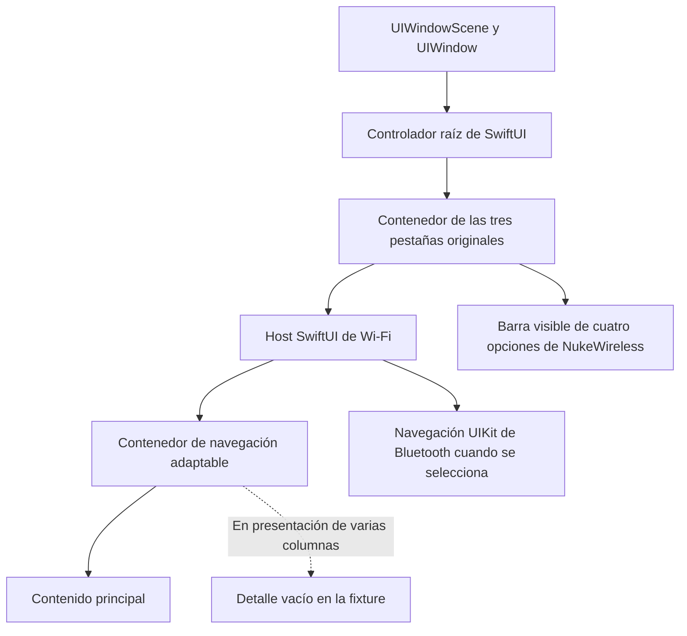

# Presentación de NukeWireless en iPadOS

Investigación del 12 de octubre de 2026, sobre `d52d400`, documentación primaria
de Apple, el ejecutable nativo fijado y los artefactos CI de la comparación
`97ba3af`. Es una revisión; no entrega una nueva corrección ni un DEB.

## Cómo se construye la pantalla

SwiftUI describe el contenido y su estado. UIKit aporta ventanas, controladores
y contenedores de navegación que alojan ese contenido. El tamaño disponible,
los traits y la política del contenedor determinan su distribución. En iPad
no basta con comprobar que una vista existe: debe estar en la ventana visible,
tener un tamaño útil y ocupar la columna que realmente se está mostrando.

La fixture registra esta estructura al arrancar:

El ejecutable nativo fijado importa el constructor y metadata de
`SwiftUI.NavigationView`; se comprobó su tabla de símbolos indefinidos, no
solo cadenas encontradas en el archivo. Esto confirma el uso nativo de ese
tipo, pero no identifica el estilo ni el contenido de cada pantalla original.
El código Swift original completo no está disponible.

## Diferencias de iPadOS que importan aquí

`NavigationView` puede presentar varias columnas con tamaño horizontal regular
y una sola columna con tamaño compacto. La clase de tamaño depende también del
espacio disponible y de la multitarea; no equivale simplemente a detectar
«es un iPad». Un estilo de pila define una navegación con una sola vista
superior visible. Fuentes: [UserInterfaceSizeClass](https://developer.apple.com/documentation/swiftui/userinterfacesizeclass)
y [StackNavigationViewStyle](https://developer.apple.com/documentation/swiftui/stacknavigationviewstyle).

Apple documenta un cambio en iOS 17: anteriormente los controladores heredaban
traits directamente del controlador padre; desde iOS 17 los heredan desde la
supervista de su vista. Por ello importan tanto la relación de contención como
la posición real de la vista. `traitOverrides` pertenece al sistema nuevo.
Fuente: [Unleash the UIKit trait system](https://developer.apple.com/videos/play/wwdc2023/10057/).

La apariencia también tiene fases. En `viewWillAppear:` la vista aún puede
no estar insertada ni tener su geometría final. Apple sitúa `viewIsAppearing:`
después de la inserción y el layout del padre, con tamaño y traits actualizados;
la API puede desplegarse desde iOS 13. Esto orienta dónde observar el estado,
pero no justifica añadir un hook sin comprobar la ruta concreta de aparición.
Fuente: [What’s new in UIKit](https://developer.apple.com/videos/play/wwdc2023/10055/?time=835).

La barra flotante superior que aparece en nuestra comparación es una
adaptación de iPadOS 18. No debe atribuirse al iPadOS 16.0 del tester.
Fuente: [Elevate your tab and sidebar experience in iPadOS](https://developer.apple.com/videos/play/wwdc2024/10147/).

## Lo observado en NukeWireless

La [evidencia extraída](evidence/ipad-rendering-analysis.json) registra los
imports nativos, hash del ejecutable y hashes de las jerarquías comparadas.

| Caso de la fixture iPadOS 18.5 | Estructura de navegación observada |
| --- | --- |
| Ruta moderna de traits | Un hijo del contenedor dividido, a todo el ancho |
| API anterior forzada | Dos hijos; el detalle aloja un `EmptyView` |

La ruta moderna pasó las 46 comprobaciones y cuatro ciclos de segundo plano
por idioma. La alternativa pasó las 20 comprobaciones iniciales, pero la
primera comprobación de retorno detectó tamaño regular (código 42), con el
mismo PID. Sus capturas ya muestran varias columnas en el arranque.
La prueba inicial no comprobaba esa geometría. Véase la
[comparación completa](https://github.com/Gokuencinar/NukeWireless/actions/runs/38236583154).

Forzar la API anterior sobre 18.5 no restaura el sistema de herencia anterior
a iOS 17. Ese experimento permite comparar las dos ramas de nuestro código
en 18.5, pero no valida ni refuta su funcionamiento en el runtime real 16.0.

## Puntos concretos del código que requieren atención

1. `legacyPadTraits` en `src/NWMainTabs.m` aplica el tamaño compacto al tab desde
   su padre si existe; solo aplica overrides directos a los hosts cuando no
   existe padre. Todavía no se ha observado qué traits efectivos reciben tab,
   host y navegación en el iPadOS 16 físico.
2. `tabForController` en `src/NukeWirelessInfo.m` reconoce el tab recibido o un
   tab ancestro. No busca un tab descendiente del controlador raíz. Por ello,
   la llamada inicial sobre un root hosting como el observado en la fixture
   no localiza por sí sola sus pestañas: depende de las llamadas de aparición
   posteriores. Es un punto ciego estático, no una causa física demostrada.
3. `prepareInfoTab` y `prepareHotspotTab` añaden navegación UIKit al host
   original y ocultan sus otras subvistas directas. Bluetooth se contiene en
   el host Wi-Fi. Hay que contrastar visibilidad y tamaño después de la
   adaptación, además de comprobar que los controladores se crearon.
4. `installUI` modifica traits antes de activar su guarda `installingUI`.
   Una reentrada síncrona durante esa adaptación es una hipótesis a medir;
   esta revisión no demuestra que ocurra.

## Hipótesis y siguiente comprobación

Una navegación regular que oculta el panel principal y deja visible un
detalle sin contenido puede producir «aparece el menú y desaparece» sin
terminar el proceso. Es compatible con las observaciones de la fixture;
no está confirmado para la pantalla negra del tester.

El `latest.json` actual puede confirmar build, modelo, iPadOS, esquema y
eventos de ciclo de vida. No registra todavía la geometría de ventanas.
Si hace falta una build de instrumentación, la observación útil debe ser
acotada y automática: unas pocas capturas de estructura al arrancar y después
de la aparición/activación, en el hilo principal, registrando ventana visible,
padres, tamaños, traits efectivos, columna mostrada y estado de la barra.
No necesita capturar textos, nombres de equipos ni direcciones de red.

La corrección debe actuar sobre el contenedor responsable con APIs públicas,
preservar los tres hosts y el delegado SwiftUI, y verificar arranque, rotación,
multitarea y retorno de segundo plano. Una comprobación de traits sobre 18.5
no sustituye la observación de iPadOS 16. No se cambia el ejecutable Swift ni
se añaden hooks por nombres de clases privadas basándose en esta investigación.
